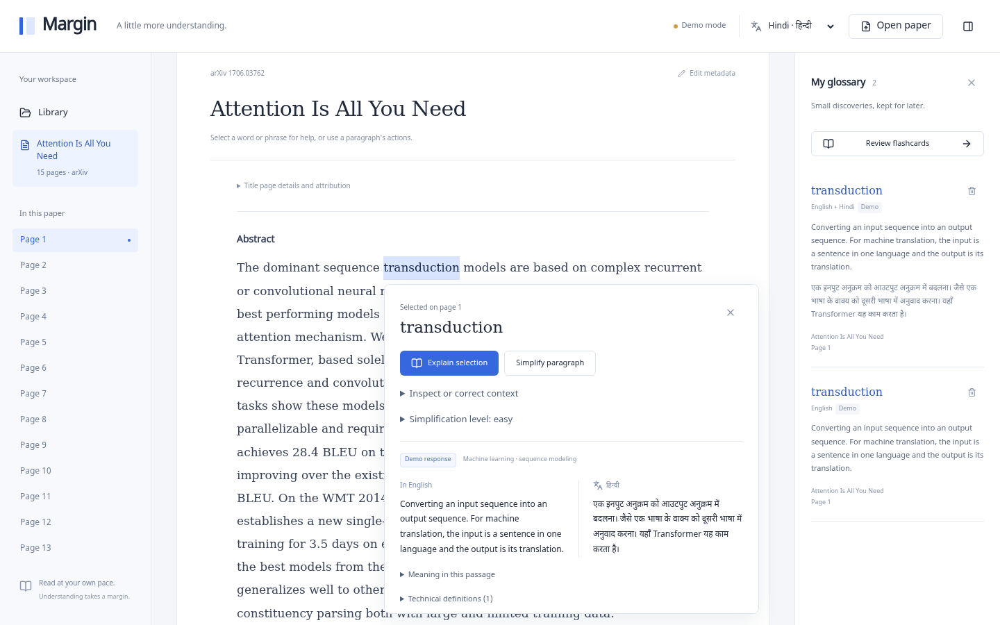

# Margin

Margin is a quiet research desk for readers learning through another language. Open a real PDF, select a technical word, and read its meaning in English beside Hindi, Telugu, Marathi, or Tamil. A saved glossary helps you return to what you learned.



## Run locally

Use Bun 1.4.4 and Node 24.22.1 or another runtime supported by Next.js 16.4.3 and PDF.js 6. React 19.3, TypeScript, Tailwind 4, and Radix-based shadcn/ui components are included. Noto fonts for the native scripts are bundled locally through Fontsource. No remote fonts are needed.

```sh
bun install
bun run dev --hostname 127.0.0.1
```

Open `http://127.0.0.1:3000`. The install, development, and build scripts copy the installed PDF.js worker into `public/`. The generated worker is ignored by Git and must match the installed PDF.js version.

For a production build:

```sh
bun run build
bun run start --hostname 127.0.0.1
```

## Read a paper

1. Choose **Read Attention Is All You Need** to fetch the actual [Vaswani et al. paper from arXiv](https://arxiv.org/abs/1706.03762). No paper content is substituted or bundled.
2. Or choose **Open paper**, then upload a PDF or enter an arXiv ID or HTTPS abstract or PDF link. Modern IDs and old IDs such as `hep-th/9901001` are accepted.
3. Choose **Text** for comfortable PDF-extracted paragraphs or **PDF** for the original page and selectable PDF.js text layer. Navigate pages with the toolbar or sidebar.
4. Select a word or phrase with the mouse or keyboard. Choose **Explain selection** in the floating panel. **Inspect or correct context** lets you edit the selected term and surrounding paragraph.
5. Choose a native language in the header. English shows the English explanation alone. Re-run the action after changing the language.
6. Use **Simplify paragraph**. Expand **Simplification level** to adjust the reading-level slider, then re-run the action. Expand **Original paragraph** to compare it with the rewrite. Underlined technical terms open keyboard-accessible definitions. Paragraph action buttons also work without selecting text.
7. Looked-up terms enter **My glossary** automatically, with their context sentence, paper, page, language, and demo or live source. Expand a term to inspect its context, remove it, or choose **Review flashcards** to reveal and advance through meanings.

Metadata comes from the PDF title and first-page extracted abstract. Use **Edit metadata** to correct it, especially for local uploads. Metadata is sent with the selected term and paragraph for assistance. The library and page outline describe the current in-memory document. This prototype does not store a PDF library across reloads.

## Optional live assistance

Without credentials, the interface clearly shows **Demo mode**. No API key is required to try the reading and glossary flows. `.env.example` documents the names. Supply keys through your own server environment. Real secret files are not part of this repository.

| Environment variable           | Purpose                                           |
| ------------------------------ | ------------------------------------------------- |
| `OPENAI_API_KEY`               | OpenAI credentials                                |
| `ANTHROPIC_API_KEY`            | Anthropic credentials                             |
| `GOOGLE_GENERATIVE_AI_API_KEY` | Google Generative AI credentials                  |
| `AI_PROVIDER`                  | Optional `openai`, `anthropic`, or `google`       |
| `AI_MODEL`                     | Optional model override for the selected provider |

With no explicit provider, the first configured key wins in the order OpenAI, Anthropic, Google. Defaults are `gpt-4.1-mini`, `claude-sonnet-4-20250514`, and `gemini-2.5-flash` respectively. Model availability depends on your account; override retired or unavailable defaults with `AI_MODEL`.

`src/lib/assistance/provider.ts` is the only module that imports the Vercel AI SDK or reads provider credentials. It uses schema-validated structured output. A missing key for the selected provider returns labeled demo output. An invalid configuration or a configured provider failure returns an error, never a silent demo fallback. Requests have a 45-second provider timeout, and the client aborts or ignores obsolete results when selection, paper, page, language, or difficulty changes. Cancelled results never enter the glossary.

The curated demo covers attention, transduction, recurrent networks, Transformer, encoder, decoder, and convolution in the Attention paper's context. Definitions and native-language explanations are authored examples, not model output. Unknown terms get an explicitly generic fallback rather than an invented definition. Demo simplification makes conservative wording substitutions in the actual selected paragraph and preserves technical terms; it does not provide full AI rewriting or native-language paragraph translation. The technical level preserves the original wording. These limits appear with each demo response.

## Privacy and limits

- Local PDFs remain in browser memory. PDF parsing and text extraction run locally. Reloading closes the reading session.
- arXiv imports pass through a stateless server route. It accepts only valid arXiv identifiers and arxiv.org hosts, follows at most three allowlisted PDF redirects, caps downloads at 20 MB, and times out after 25 seconds. It cannot fetch an arbitrary URL.
- Live assistance sends only the selection, surrounding paragraph, title, abstract, language, and difficulty to the configured AI provider. Do not use confidential text unless that provider's policies meet your needs. Demo assistance makes no provider request.
- Glossary entries, including selected context and explanations, persist in this origin's `localStorage`. This is not encrypted storage. Remove individual terms in the glossary. Storage corruption, blocked storage, and quota failures appear visibly; in-memory entries remain usable. **Reset storage and save session** replaces damaged stored data with this session's entries.
- Maximum PDF size is 20 MB and maximum length is 500 pages. Encrypted PDFs requiring passwords and scanned PDFs without a text layer are not supported. OCR is not included.
- PDF paragraph grouping and metadata inference are heuristic. Complex multi-column layouts, equations, tables, footnotes, and hyphenation can produce imperfect order or grouping. Inspect or correct context before relying on an explanation.
- Citation and equation previews are deferred. No citation hover previews, equation interpretation, annotations, cloud accounts, or cross-device sync are included.
- Live output can be wrong. Check important interpretations against the paper. The prototype has no authentication, durable server storage, rate limiting, or deployment hardening and should stay local until those are added.

## Validate changes

```sh
bun run format:check
bun run lint
bun run typecheck
bun run test
bun run build
```

`bun run format` formats source. The Bun unit tests cover arXiv acceptance and rejection, bounded streamed PDF reads, PDF signatures, assistance schemas and curated multilingual responses, context-dependent simplification, honest fallbacks, paragraph extraction, metadata inference, and versioned glossary deduplication and persistence validation.

Playwright 1.64.1 is pinned for repeatable browser tests. Build first. `playwright.config.ts` starts and stops its own loopback production server, uses one worker, preserves traces on failure, and launches `/usr/bin/chromium` with `INSTABOX_HEADLESS=1`. It does not download browsers or reuse an unrelated service on port 3000.

```sh
bun run build
bun run test:e2e
```

The four E2E tests import the real arXiv paper, select words with the mouse in text and PDF views, assert the request includes surrounding text and metadata, exercise every native language, change simplification levels and open definitions, verify glossary persistence and flashcards, recover damaged storage, and reject invalid API requests. A delayed-response test proves that changing language cancels obsolete help without saving it.

Diagnostics attach before navigation and record console errors, uncaught page errors, failed requests, and HTTP 4xx/5xx responses. The cancellation test explicitly expects one aborted assistance request; it records that cancellation separately. All other browser error categories must remain empty. Screenshots go to `artifacts/`; traces and the HTML report go to `test-results/` and `playwright-report/`. Viewport checks cover 1440×900, 768×1024, and 390×844. Chromium viewport checks do not establish Safari, Firefox, or real-device support. Successful live-provider generation requires your credentials and is not covered by the demo suite.

Useful locators for verification:

- Demo button: `getByRole('button', { name: 'Read Attention Is All You Need' })`.
- File input: `getByLabel('Choose a local PDF')`. arXiv input: `getByLabel('arXiv link or ID')`.
- Reader paragraphs: `[data-paragraph]`, with the exact extracted paragraph in `data-paragraph`. Text container: `getByTestId('extracted-content')`.
- PDF layer: `.textLayer span`, inside `getByTestId('pdf-page')`.
- Floating panel: `getByRole('dialog', { name: 'Selection help' })`. Scope **Explain selection** and **Simplify paragraph** to that dialog because the paragraph actions have the same accessible names.
- Context fields: `getByLabel('Selected term')` and `getByLabel('Surrounding paragraph')`. Expand **Inspect or correct context** first.
- Result: `getByTestId('assistance-result')`. Simplified text: `.simplified-paragraph`. Definitions: `getByRole('button', { name: 'Define attention', exact: true })`.
- Language: `getByRole('combobox', { name: 'Native language' })`. Page: `getByRole('combobox', { name: 'Page', exact: true })`.
- Saved glossary: `getByRole('complementary', { name: 'Saved glossary' })`. Entries: `.glossary-entry`.
- Flashcard answer: `getByTestId('flashcard-answer')`, after **Review flashcards** and **Reveal meaning**.
- On tablet and mobile, choose **Show glossary** to open the dismissible glossary panel. Choose **Pages** for the dismissible page navigation.

See [ARCHITECTURE.md](ARCHITECTURE.md) for module ownership. [AI SDK structured output](https://ai-sdk.dev/docs/reference/ai-sdk-core/output) and [PDF.js examples](https://mozilla.github.io/pdf.js/examples/) describe the upstream APIs. App code is MIT licensed. Dependencies and papers retain their own licenses and attribution.

## Prototype verification

The November 1, 2026 verification passed formatting, lint, type checking, 53 Bun unit tests, a production build, and all four Chromium E2E tests. The suite used the real 15-page arXiv PDF for import and upload. Desktop, tablet, and mobile screenshots were captured and inspected. Test-owned browsers and servers were stopped.

Review and browser testing found and fixed occurrence matching that could attach a PDF word to its title instead of its paragraph, paragraph spacing that merged separate passages, an unsafe statistical wording substitution, missing validation of the requested output language, and sidebar overlap. Lint also needed explicit exclusions for generated Playwright reports after the first browser run. Application source and test code remain covered by lint.

The demo suite reports no unexpected console errors, page errors, failed requests, or HTTP errors. Its cancellation test explicitly checks one expected aborted request. An independent static recheck found no remaining concrete issues. Successful live-provider generation, Firefox, Safari, real touch-device selection, OCR, and citation or equation previews remain unverified or outside this prototype.
